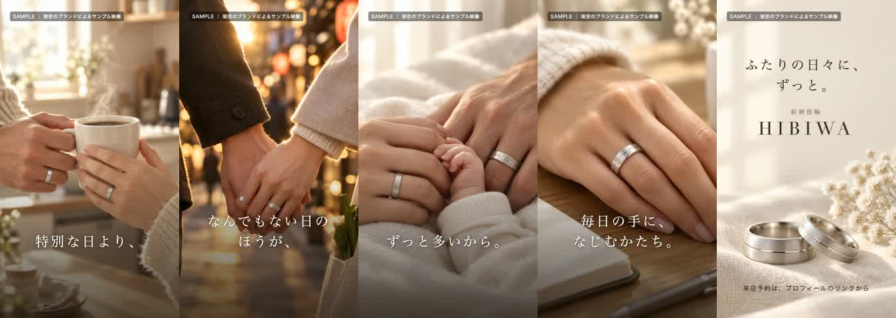

指輪を着けて、マグカップを持つ。手をつないで歩く。家族の手が重なる。

SOIが2026年9月に制作した架空の指輪ブランド「HIBIWA」のサンプルは、こうした日常の場面を5枚の画像で構成しています。ツイミルの制作ノートとして、実際の素材と編集工程を紹介します。

※架空ブランドの制作サンプルです。実在する商品の紹介や、顧客の広告成果を示すものではありません。

## 5枚の順番と、5つの言葉

| 場面 | 画面の言葉 |
|---|---|
| マグカップを持つふたりの手 | 特別な日より、 |
| 手をつないで歩く場面 | なんでもない日のほうが、 |
| 家族の手が重なる場面 | ずっと多いから。 |
| 指輪のある日常の手元 | 毎日の手に、なじむかたち。 |
| ブランド名と指輪 | ふたりの日々に、ずっと。 |

作品では、最後のブランド紹介まで言葉がつながります。指輪のある生活を見せてから、商品名と来店予約の案内へ進む構成です。

## 画像に加えた動き

このサンプルでは、生成した静止画を編集で動かしています。ゆっくり寄る、横へ動く、少し引くという変化を場面ごとに付け、次の画像へ重ねながら切り替えました。文字も画像に焼き込んだものではなく、編集工程で重ねています。

編集ファイルでは、1場面を4.4秒として5場面を並べ、4か所の切り替えでそれぞれ0.7秒を重ねています。

**4.4秒 × 5場面 − 0.7秒 × 4か所 ＝ 19.2秒。**

完成ファイルも、縦1080×1920ピクセル、19.2秒であることを確認しました。この19.2秒は完成動画の長さで、制作にかかった時間ではありません。

## この作品から説明できること

ここで紹介したのは、画像の順番、言葉、カメラの動きに見える編集、切り替えを組み合わせた制作工程です。広告としての配信結果や、来店への影響を測った作品ではありません。

ツイミルでは、商品・サービスの広告動画やショートドラマを、企画から編集までご相談いただけます。手元にある写真や動画も確認し、用途に合わせて必要な素材と表現を整理します。

[ツイミルの動画制作について](/tsuimiru/)
